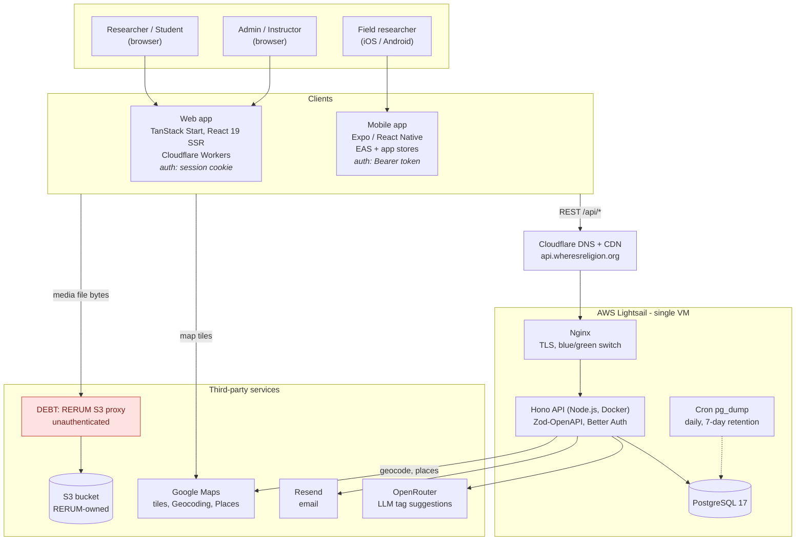
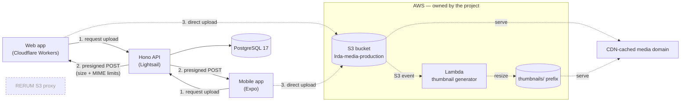
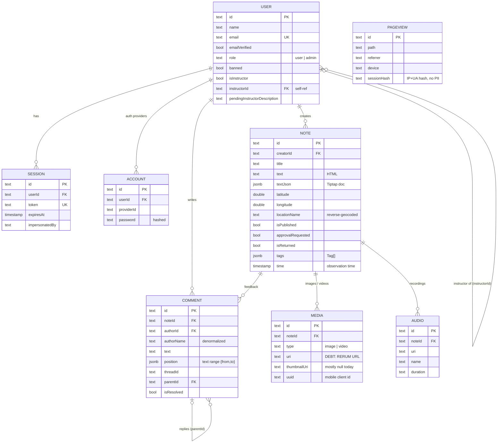
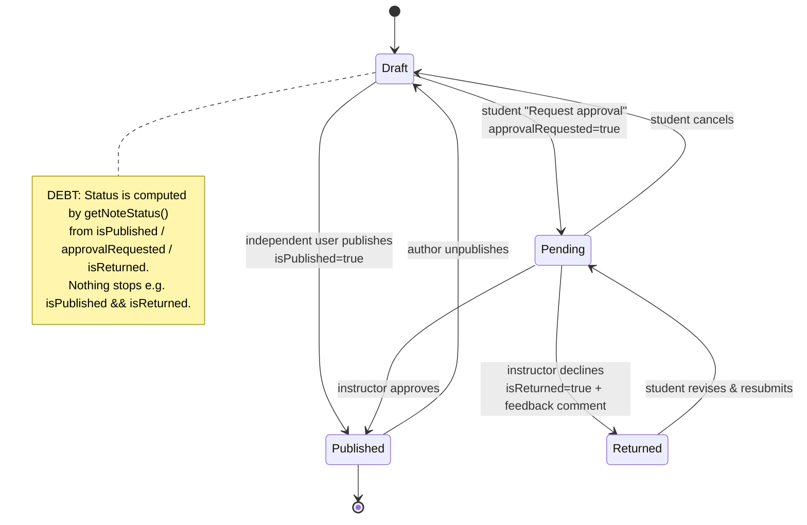
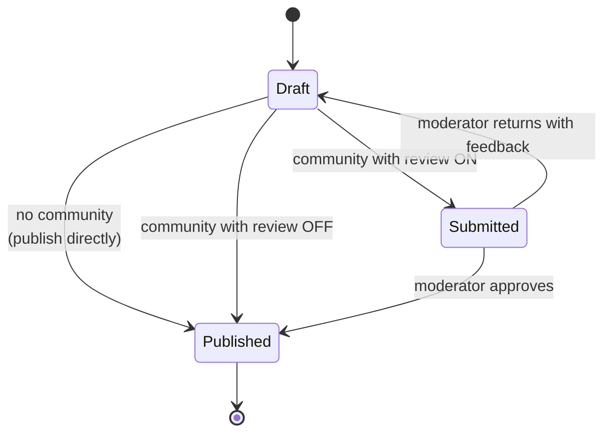
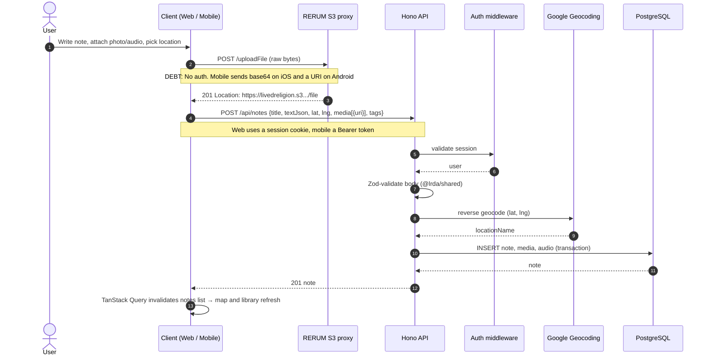
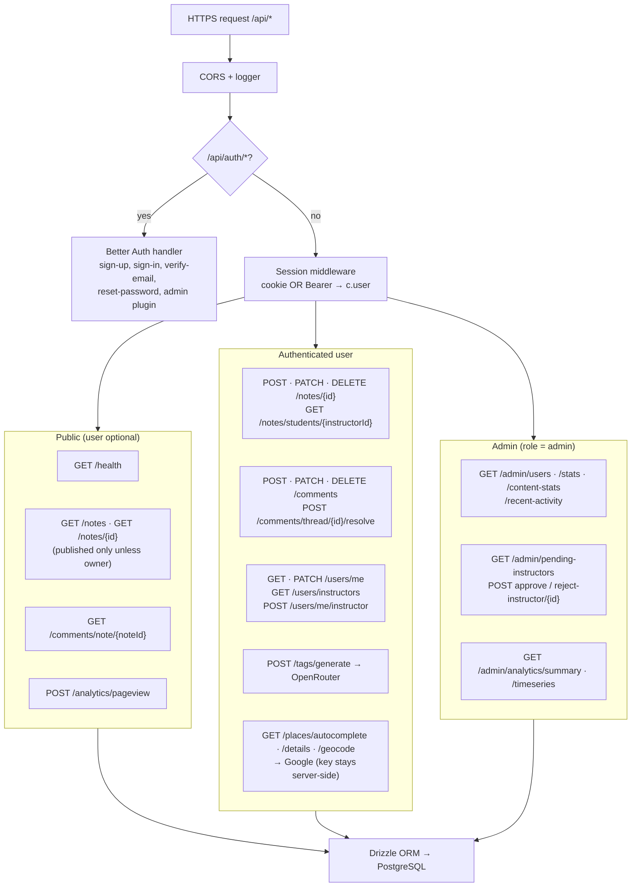
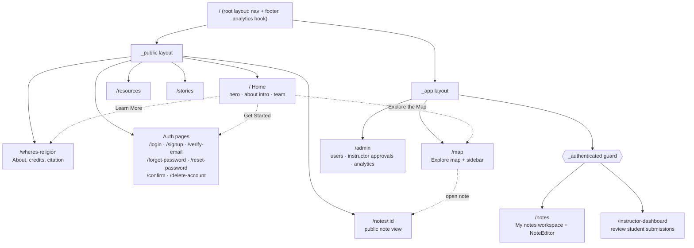
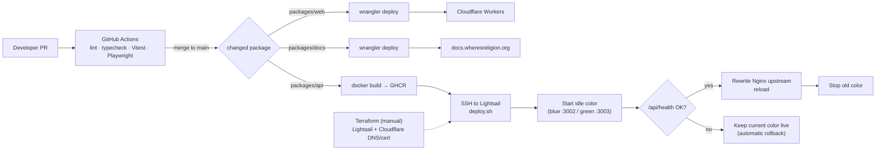

# Where's Religion? — System Design Artifacts

Visual design artifacts for the Where's Religion? platform: the web app (this repo), the shared Hono API (this repo) and the mobile app ([`lrda_mobile`](https://github.com/oss-slu/lrda_mobile)).

All diagrams are [Mermaid](https://mermaid.js.org/) and render on GitHub. To edit one, paste it into [mermaid.live](https://mermaid.live).

**Legend used throughout:** solid line = current state · dashed line = planned or future state · **DEBT** = known technical debt (red nodes)

| # | Artifact | Type | Notation |
|---|---|---|---|
| 1 | [System architecture (current)](#1-system-architecture--current-state) | Component / deployment | C4-style container diagram |
| 2 | [System architecture (intended)](#2-system-architecture--intended-future-state) | Component / deployment | C4-style container diagram |
| 3 | [Data model](#3-data-model-erd) | Entity relationship | Crow's-foot ERD |
| 4 | [Note lifecycle (current vs. intended)](#4-note-lifecycle--state-diagrams) | State | UML state machine |
| 5 | [Create-note data flow](#5-data-flow--creating-a-note-with-media) | Data flow | UML sequence |
| 6 | [API architecture](#6-api-architecture--endpoint-groups-and-auth) | API endpoint map | Flowchart |
| 7 | [Web information architecture](#7-web-information-architecture) | Information architecture | Hierarchy flowchart |
| 8 | [CI/CD and deployment](#8-cicd-and-blue-green-deployment) | Deployment | Flowchart |
| 9 | [Technical debt map](#9-technical-debt-map) | Annotated summary | Table |

Mobile-specific artifacts (navigation, module layers, offline and media capture) are in [`lrda_mobile/docs/design/mobile-design.md`](https://github.com/oss-slu/lrda_mobile/blob/main/docs/design/mobile-design.md).

---

## 1. System architecture — current state

**Key points**
- **One API, two clients.** The docs site (`docs.wheresreligion.org`) is also on Cloudflare Workers but is left out of the diagram.
- **Shared backend.** The web and mobile apps both use the same Hono API and PostgreSQL database. `@lrda/shared` (Zod schemas) is the contract between the API and the web app.
- **Different auth transport per client.** Web uses httpOnly session cookies. Mobile uses the Better Auth `bearer()` + `expo()` plugins, with the token kept in SecureStore.
- **DEBT: Media bypasses the API.** Both clients send file bytes straight to RERUM's unauthenticated proxy and store the returned URL on the note. We don't own that storage and there are no thumbnails.

---

## 2. System architecture — intended future state

The differences from §1 are drawn with dashed lines (sources: [`media-s3-thumbnails-plan.md`](../media-s3-thumbnails-plan.md), [`communities-design.md`](../communities-design.md)).

| Area | Current | Intended |
|---|---|---|
| Media storage | RERUM proxy, no auth, full-size originals only | Project-owned S3, auth via presigned POST, Lambda thumbnails, all existing media migrated |
| Review model | Instructor ↔ student (`user.instructorId`) | Communities with owner / moderator / member roles (see §4) |
| Environments | Single production (staging was folded into production) | Unchanged |

---

## 3. Data model (ERD)

Source: `packages/api/src/db/schema.ts` (Drizzle). Better Auth owns `session`, `account` and `verification`.

**Design decisions shown**
- **Tags live in a `jsonb` array on `note`, not a join table.** This keeps reads simple, but there's no tag vocabulary or tag-level querying yet.
- **Note text is stored twice:** `text` (HTML, used for search and previews) and `textJson` (Tiptap document, used for editing). DEBT: The two can drift apart.
- **Note status is three booleans, not a single enum.** DEBT: This permits invalid combinations (see §4).
- `pageView` stands alone and has no relationships, which keeps analytics free of PII by design.

---

## 4. Note lifecycle — state diagrams

### 4a. Current (instructor/student, derived from three booleans)

### 4b. Intended (communities)

**Trade-off:** the intended model replaces "one instructor per student" with "many communities per user". It needs new `community` and `community_member` tables and a single `status` enum in place of the three booleans.

---

## 5. Data flow — creating a note with media

The same flow runs on web and mobile; the differences are noted.

---

## 6. API architecture — endpoint groups and auth

Every route is defined with `@hono/zod-openapi`. Interactive docs are served at `/reference` (Scalar).

**Decision:** Google Places calls go through `/api/places/*` so the server-side Maps key is never sent to the browser. Only the restricted map-display key is public (`VITE_MAP_KEY`).

---

## 7. Web information architecture

TanStack Router uses file-based routes (`packages/web/src/routes`). The `_public` and `_app` layouts decide the chrome, and `_authenticated` guards its routes.

`/`, `/resources` and `/wheres-religion` are pre-rendered and served as static assets.

---

## 8. CI/CD and blue/green deployment

The mobile app ships separately through EAS Build / app stores (see the mobile design doc).

---

## 9. Technical debt map

| Debt | Where | Impact | Planned fix |
|---|---|---|---|
| Unauthenticated third-party media storage | `utils/s3_proxy.ts` (web), `lib/utils/S3_proxy.ts` (mobile) | Anyone can upload; data lives outside the project | Presigned S3 + Lambda (§2) |
| No thumbnails; 8 MP originals shown at 256 px | Map sidebar, cards | About 5.6 s spent decoding images on the note detail page | Thumbnail pipeline (§2) |
| Note status as three booleans | `note` table, `getNoteStatus()` | Invalid states are possible | `status` enum with communities (§4b) |
| Duplicated note body (`text` + `textJson`) | `note` table | HTML and JSON can disagree | Derive HTML from JSON on write |
| Single VM runs API + DB + backups | Lightsail | Single point of failure; backups stay on the same disk unless S3 is configured | Turn on off-box S3 backups first, then consider managed Postgres |
| Mobile architecture doc is out of date | `packages/docs/mobile/architecture.md` | Describes Redux / React Navigation / Yarn, but the app uses Zustand / expo-router / pnpm | Replace with `lrda_mobile/docs/design` |
| Mobile has no shared schema package | `lrda_mobile/types.ts` | API contract can drift without notice | Publish `@lrda/shared` for mobile to import |
